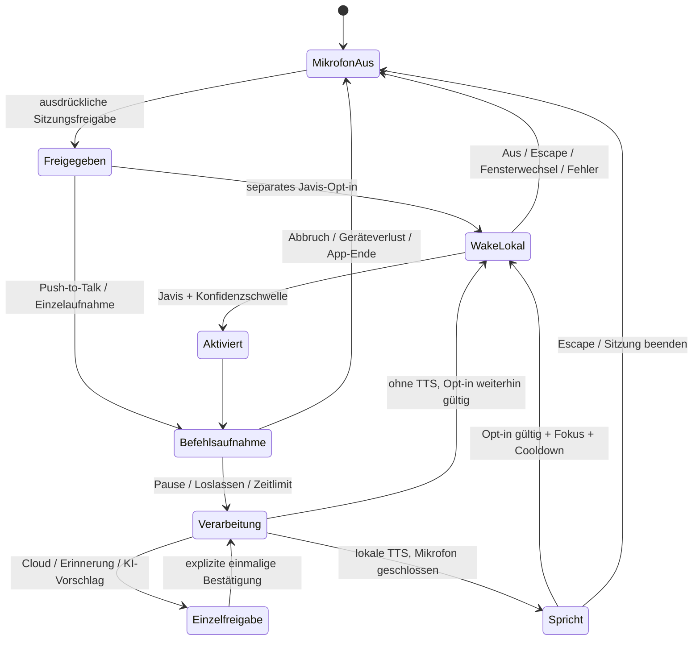

# Lokale Voice-Architektur 1.4

## Entscheidung und überprüfbare Grenzen

Der bestehende Windows-PowerShell-5.1-/C#-5-/System.Speech-Host wird erweitert.
Audio bleibt vollständig in einem lokalen Hilfsprozess. Web Speech APIs der
WebView2-Laufzeit werden nicht verwendet; deren Browserabhängigkeit und mögliche
Cloud-Erkennung wären kein verlässlicher lokaler Tauri-2-Pfad.

Es gibt eine reale `Choices("Javis")`-Grammatik und eine Kombinationsgrammatik
`Javis + AppendDictation()`, ausschließlich mit einem installierten de-DE-Erkenner.
Nach dem einzelnen Wake Word wird die Diktatgrammatik im Recognizer-Update aktiviert.
Der Kombinationspfad übernimmt einen vollständig erkannten Befehl aus derselben
Äußerung. Ein Sprecher sollte zunächst die Aktivierungsanzeige abwarten.

**Nicht nachgewiesen:** Aussprachequalität, Akzente, Distanz, Falschauslösungsrate,
Trefferquote, Latenz, CPU-/RAM-Verbrauch des Windows-SAPI-Modells und reale
Mikrofonkompatibilität. Die statische Kompilierung ersetzt keine Audioaufnahme.
Bei fehlender/fehlerhafter Grammatik schaltet die App ab, statt Erkennung zu simulieren.
Push-to-Talk bzw. einmaliges Zuhören ist die Alternative ohne Wake-Grammatik.
Ohne Mikrofon/de-DE-Erkenner stehen Tastatur- und Mausaktionen der Module zur Verfügung.

## Technologievergleich

| Technologie | Lizenz/Abhängigkeit | Windows und „Javis“ | Ressourcen/Entscheidung |
|---|---|---|---|
| System.Speech / Desktop-SAPI | Windows-/Microsoft-Laufzeitbedingungen; keine Umverteilung der Betriebssystem-DLLs | Desktop-Windows, lokale de-DE-Grammatik bei installiertem Erkenner; OOV-/Aussprachequalität offen | Kein zusätzlicher Modell-Download durch die App. Vollwertiger Spracherkenner, kein schlanker spezialisierter Hotword-DSP. Native CPU/RAM nicht gemessen. Gewählter Pfad. |
| openWakeWord | Code Apache-2.0, mitgelieferte vortrainierte Modelle laut README CC BY-NC-SA 4.0 | Windows über ONNX Runtime; kein in diesem Projekt validiertes deutsches „Javis“-Modell | Zusätzliches Inferenzmodell/Runtime und eigene Trainings-/Validierungsarbeit nötig. Keine erfundenen Ressourcenwerte; nicht integriert. |
| Porcupine | Repository-Lizenz Apache-2.0; AccessKey/Console und jeweilige Nutzungs-/Modellbedingungen beachten | Windows x64 und benutzerdefinierte Wake-Modelle laut Hersteller | Zusätzliche SDK-/Modell-/Kontoverwaltung; konkrete Offline-/kommerzielle Bedingungen separat prüfen. Nicht integriert, keine Zugangsschlüssel mitgeliefert. |

Offizielle Quellen, am 12.11.2026 gelesen:
- https://learn.microsoft.com/en-us/dotnet/api/system.speech.recognition.grammarbuilder.appenddictation?view=netframework-4.8
- https://learn.microsoft.com/en-us/dotnet/api/system.speech.recognition.speechrecognitionengine?view=netframework-4.8
- https://learn.microsoft.com/en-us/windows/win32/api/mmeapi/nf-mmeapi-waveinopen
- https://learn.microsoft.com/en-us/previous-versions/dd743849(v=vs.85)
- https://github.com/dscripka/openWakeWord#license
- https://github.com/Picovoice/porcupine

## Audio- und Prozessgrenzen

`audio_devices.rs` liest WinMM-Geräte und, soweit verfügbar, das bevorzugte
Standardgerät. Abfragen öffnen kein Mikrofon. IDs bestehen aus aktuellem Index
und Namen, nicht aus einem persistenten Endpoint-GUID. Der Host prüft die Auswahl
vor dem Öffnen erneut und fällt bei einem verlorenen expliziten Gerät niemals
stillschweigend auf ein anderes zurück.

`AudioCapture.cs` führt 16-kHz-/16-Bit-/Mono-PCM über WinMM in einen nicht suchbaren
Stream. Vier native Puffer à 3.200 Byte und eine begrenzte Queue mit 16 Blöcken
begrenzen den PCM-Speicher auf ungefähr 68 KB zuzüglich Laufzeit-/Objektkosten.
Das ist eine aus dem Code abgeleitete Puffergrenze, **kein** Windows-RAM-Benchmark.
Es werden keine Audio-Dateien angelegt. Überlast, fehlende Daten, Geräteverlust
oder Formatfehler führen zum Abbruch. WinMM-Aufrufe zum Wiedereinreihen erfolgen
auf einem eigenen Thread, nicht im waveInProc-Callback.

Der Host liefert nur Zustände, Transkripte und echte `AudioLevelUpdated`-Werte
(0–100, keine dB). C# läuft mit festen lokal mitgelieferten Quelldateien. Texte
werden über BOM-freies UTF-8-stdin übergeben, niemals als PowerShell-Befehl,
SSML oder Dateipfad ausgeführt.

Rust verwaltet genau einen Audio-Hilfsprozess. Cancellation-Epochen verhindern,
dass ein bereits abgebrochener Start später doch ein Mikrofon öffnet. Alte
Sitzungskennungen dürfen neuere Sitzungen nicht stoppen. Start/Snapshot/Finish/
Cancel, Prozessüberwachung und Windows-Fensterereignisse bleiben im Backend.
Ein Beenden wird erst nach bestätigtem Prozessende quittiert; bei Fehler zeigt
die Oberfläche einen **unbestätigten** Mikrofonzustand und sperrt automatische
Reaktivierung/weitere Sprachverarbeitung. Es gibt keine vorgetäuschte Aus-Anzeige.

## Zustandsautomat

Konfidenzschwelle 0,50–0,95 (Standard 0,70) filtert erkannte Ergebnisse. Sie ist
keine gemessene Genauigkeit oder trainierbare akustische Modellempfindlichkeit.
Sprechpause 0,8–3 Sekunden (Standard 1,6), initiale Stille maximal 8 Sekunden,
Befehl maximal 30 Sekunden. Ein Wake-Zyklus wird nach fünf Minuten kontrolliert
erneuert. TTS ist auf drei Minuten begrenzt. Rust überwacht zusätzlich die Prozesse.

Während Verarbeitung und TTS ist Aufnahme gesperrt. Nach TTS gilt ein Cooldown
von 900 ms. Unterbrechung während TTS erfolgt per Knopf/Escape; stimmliches Barge-in
wird zugunsten der Rückkopplungsvermeidung nicht angeboten.

## Tauri und spätere NSIS-Verpackung

Der Windows-x64-Tauri-App-Build und das Kopieren von `VoiceHost.cs`,
`AudioCapture.cs`, `launch.ps1` wurden geprüft. Ressourcenmapping bleibt
`voice/` → `voice/`; das gilt auch für eine spätere NSIS-Verpackung.
Ein NSIS-Installer 1.4 wurde ausdrücklich nicht gebaut. Die mobilen
`cdylib`-/`staticlib`-Vorlagenartefakte wurden wegen eines tatsächlich erreichten
PE-Exportlimits im GNU-Debug-Link entfernt; Windows-Desktop benötigt das `rlib`
für seine EXE. Mobile Targets sind nicht Bestandteil dieses Projekts.
